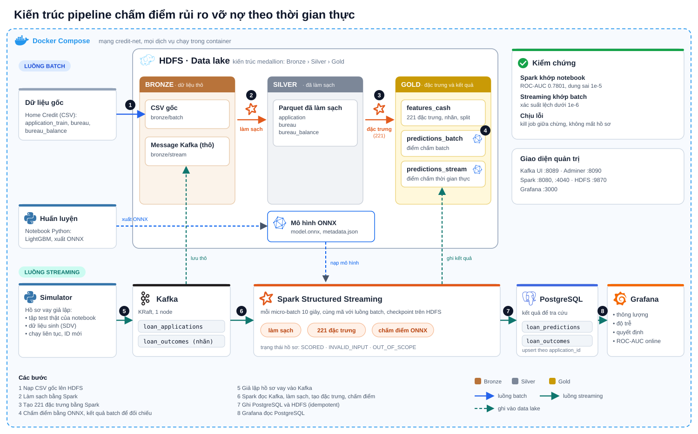

# Dự đoán rủi ro vỡ nợ tín dụng: từ huấn luyện đến vận hành

Dự án xây dựng mô hình dự đoán khả năng vỡ nợ của khách hàng vay tiền mặt (bộ dữ liệu [Home Credit Default Risk](https://www.kaggle.com/c/home-credit-default-risk)) và đưa mô hình vào một pipeline Data Engineering chấm điểm hồ sơ vay theo thời gian thực.

Bài toán có nhãn mất cân bằng nặng: chỉ khoảng 8,35% hồ sơ vỡ nợ.

## Hai phần của dự án

| Thư mục | Nội dung | Tài liệu chi tiết |
|---|---|---|
| [training](training/) | Notebook huấn luyện: EDA, tiền xử lý, xử lý lệch nhãn, RandomForest / XGBoost / LightGBM, xuất ONNX, giải thích bằng SHAP | [training/README.md](training/README.md) |
| [pipeline](pipeline/) | Pipeline vận hành: HDFS, Kafka, Spark, PostgreSQL, Grafana, đóng gói bằng Docker | [pipeline/README.md](pipeline/README.md) |

## Kết quả mô hình

Mô hình được chọn là LightGBM. Trên tập test hold-out 55,644 hồ sơ:

| ROC-AUC | Gini | KS | Precision lớp vỡ nợ | Recall lớp vỡ nợ | F1 lớp vỡ nợ |
|---|---|---|---|---|---|
| 0.7801 | 0.5602 | 0.4234 | 0.2673 | 0.4453 | 0.3340 |

Dữ liệu hiện có chỉ cho phép phân biệt vừa phải giữa hồ sơ tốt và hồ sơ vỡ nợ; phân tích nguyên nhân (SHAP, nhóm khách hàng dự đoán yếu) và hướng cải thiện nằm ở [training/README.md](training/README.md).

## Kiến trúc pipeline

<p align="center"></p>

Batch và streaming dùng chung một bộ mã làm sạch, tạo đặc trưng và chấm điểm. Kết quả streaming được kiểm chứng khớp với batch và với notebook huấn luyện (ROC-AUC online 0.7801 trên tập test thật).

## Hiệu năng

Đo trên laptop Intel i5-11400H, 15 GB RAM, cả cụm chạy trong Docker. Chi tiết, cách đo và giới hạn của số liệu nằm ở [pipeline/README.md](pipeline/README.md#13-benchmark).

| Thành phần | Kết quả |
|---|---|
| Kafka, ghi | 72,304 hồ sơ/s (496 MB/s trước nén), p99 32 ms, nén 15 lần |
| Kafka, đọc | 132,153 hồ sơ/s (907 MB/s) với một consumer |
| Spark batch | Cả ba job khoảng 100 giây với 4 core: làm sạch 29.3 triệu dòng, tạo 221 đặc trưng và chấm 278,220 hồ sơ |
| Spark streaming | Theo kịp khoảng 550 hồ sơ/s; ở 150 hồ sơ/s độ trễ end-to-end p50 7.8 giây, p95 10.5 giây |

## Cấu trúc thư mục

```
.
├── README.md
├── training/                 notebook huấn luyện, README mô tả mô hình, hình minh họa
├── pipeline/                 mã, cấu hình Docker và README của pipeline
├── data/                     dữ liệu gốc (không đưa lên git)
└── mlops_artifacts/          mô hình đã huấn luyện, do notebook sinh ra (không đưa lên git)
```

## Bắt đầu nhanh

1. Đặt dữ liệu Home Credit (`application_train.csv`, `bureau.csv`, `bureau_balance.csv`) vào `data/`.
2. Huấn luyện mô hình, tạo ra `mlops_artifacts/`:
   ```bash
   cd training
   python -m jupyter nbconvert --to notebook --execute --inplace main.ipynb --ExecutePreprocessor.timeout=-1
   ```
3. Chạy pipeline (cần Docker; xem yêu cầu tài nguyên trong [pipeline/README.md](pipeline/README.md)):
   ```bash
   cd pipeline
   cp .env.local.example .env.local
   cp .env.grafana.local.example .env.grafana.local
   make all
   ```

`make help` liệt kê mọi lệnh của pipeline.
