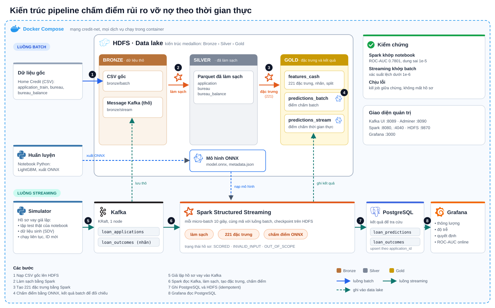

# Pipeline chấm điểm rủi ro vỡ nợ theo thời gian thực

Pipeline DE đưa mô hình LightGBM (đã huấn luyện ở [training](../training/README.md)) vào vận hành: nhận hồ sơ vay mới qua Kafka, tạo đặc trưng bằng Spark, chấm điểm bằng mô hình ONNX, lưu kết quả vào PostgreSQL và HDFS, và hiển thị trên Grafana. Toàn bộ chạy trong Docker trên một máy 15 GB RAM.

## 1. Pipeline

- **Batch:** đọc dữ liệu gốc (CSV) từ HDFS, làm sạch, tạo bảng 221 đặc trưng và chấm điểm toàn bộ. Kết quả được dùng để kiểm chứng rằng Spark tạo đặc trưng giống hệt notebook huấn luyện.
- **Streaming:** nhận từng hồ sơ vay mới từ Kafka, làm sạch, tạo đặc trưng, chấm điểm bằng đúng các hàm của batch, rồi ghi kết quả. Nhãn vỡ nợ (đến sau) vào một topic riêng để tính chỉ số mô hình online.
- **Simulator:** bộ sinh hồ sơ phát vào Kafka, gồm tập test thật được split trong notebook, dữ liệu tổng hợp theo phân phối của dữ liệu gốc, và chế độ phát liên tục để giám sát.
- **Monitor:** dashboard Grafana về thông lượng, độ trễ, quyết định và chỉ số mô hình.

Mô hình chỉ cho ra **xác suất vỡ nợ**. Cột `decision` là quy tắc cắt ngưỡng 0.658 (lấy từ `metadata.json`, ngưỡng tối ưu F1 lúc huấn luyện): `REJECT` khi xác suất vượt ngưỡng, ngược lại `APPROVE`.

## 2. Kiến trúc

<p align="center"></p>

Luồng batch (xanh dương) đi qua ba tầng medallion trên HDFS: **Bronze** (dữ liệu thô), **Silver** (đã làm sạch), **Gold** (đặc trưng và kết quả chấm điểm). Luồng streaming (xanh lục) đi từ Kafka qua Spark Structured Streaming, ghi vào PostgreSQL để Grafana đọc và ghi lại vào Bronze/Gold trên HDFS. Cả hai luồng dùng chung mã làm sạch, tạo đặc trưng và chấm điểm, và cùng nạp mô hình ONNX từ HDFS.

<sub>Logo công cụ: [Simple Icons](https://simpleicons.org) (CC0), thuộc quyền của chủ sở hữu từng thương hiệu. File nguồn: [docs/architecture.svg](docs/architecture.svg).</sub>

## 3. Công cụ

| Thành phần | Image / phiên bản | Vai trò |
|---|---|---|
| HDFS | `apache/hadoop:3.4.2` (1 NameNode, 1 DataNode, replication 1) | Lưu dữ liệu gốc, các tầng silver/gold, mô hình, checkpoint |
| Kafka | `apache/kafka:4.2.2` (KRaft, 1 node) | Hàng đợi hồ sơ và nhãn |
| Spark | `apache/spark:4.1.3-python3` (standalone, 1 master, 1 worker 4 core) | Batch và Structured Streaming |
| PostgreSQL | `postgres:17.11-alpine` | Kết quả chấm điểm để tra cứu và cho Grafana |
| Grafana | `grafana/grafana-oss:12.4.3` | Dashboard giám sát |
| Kafka UI, Adminer | `kafbat/kafka-ui:v1.5.0`, `adminer:6.1.2` | Xem message và duyệt bảng |
| Mô hình | LightGBM xuất ONNX, chạy bằng `onnxruntime 1.23.2` trong `mapInPandas` | Chấm điểm |
| Sinh dữ liệu | SDV 2.0.0 (GaussianCopula) | Hồ sơ tổng hợp |

## 4. Dữ liệu trên HDFS

```
/datalake/bronze/batch/{application_train,bureau,bureau_balance}/   CSV gốc
/datalake/bronze/stream/{loan_applications,loan_outcomes}/batch_id=N/   message thô từ Kafka
/datalake/silver/{application,bureau,bureau_balance}/               Parquet đã làm sạch
/datalake/gold/features_cash/                                       278,220 hồ sơ × 221 đặc trưng, kèm TARGET và split
/datalake/gold/predictions_batch/                                   điểm chấm bằng batch
/datalake/gold/predictions_stream/batch_id=N/                       điểm chấm bằng streaming
/datalake/reference/{holdout_ids,notebook}/                         tập test và bảng tham chiếu của notebook
/models/credit_default/lightgbm/v1/{model.onnx,metadata.json}       mô hình
/checkpoints/{stream_applications,stream_outcomes}/                 checkpoint của streaming
```

## 5. Luồng batch

| Lệnh | Việc làm | Kết quả |
|---|---|---|
| `make silver` | Làm sạch CSV: đổi mã hưu trí `365243` thành null, sửa giá trị sai logic ở bureau, đổi trạng thái tháng thành mức quá hạn | 3 bảng Parquet, số dòng khớp CSV gốc |
| `make features` | Tạo 221 đặc trưng (tỉ lệ, tổng hợp điểm tín dụng ngoài, one-hot, gom bureau theo khách hàng, biến tương tác), lọc Cash loans | `gold/features_cash` kèm cột `split` train/test của notebook |
| `make score` | Chấm điểm bằng ONNX, tính ROC-AUC tập test | `gold/predictions_batch`, báo lỗi nếu ROC-AUC lệch notebook quá 1e-5 |
| `make compare STAGE=...` | So từng cột đặc trưng Spark với bảng tham chiếu xuất từ notebook (cần `make reference hdfs-reference` trước) | báo cột nào lệch, lệch bao nhiêu |

Các chỗ Spark khác pandas và được xử lý riêng: chia cho 0 (Spark 4 bật ANSI nên báo lỗi), tổng của nhóm toàn null (pandas ra 0, Spark ra null), so sánh với null, độ lệch chuẩn tính theo dòng, và quy tắc điền giá trị thiếu theo tên cột.

## 6. Luồng streaming

Job `spark-stream` (file `jobs/stream_score.py`) chạy hai query, mỗi 10 giây:

1. **loan_applications:** lưu message thô vào bronze, parse JSON, loại bản trùng trong cùng batch (giữ offset lớn nhất), tách thành ba bảng hồ sơ, khoản vay, lịch sử tháng, chạy đúng các hàm của batch, rồi ghi `gold/predictions_stream` và upsert `loan_predictions`.
2. **loan_outcomes:** ghi nhãn vào bronze và upsert `loan_outcomes`.

Mỗi hồ sơ nhận một trạng thái: `SCORED` (Cash loans, đủ số tiền), `INVALID_INPUT` (thiếu số tiền cần thiết) hoặc `OUT_OF_SCOPE` (không phải Cash loans, mô hình không học loại này). Hồ sơ không chấm điểm vẫn được ghi nhận.

Log của job báo từng batch (số message, số hồ sơ theo trạng thái, thời gian xử lý) kèm tổng số hồ sơ đã chấm từ lúc khởi động, và cứ mỗi phút báo "vẫn đang chạy" khi không có hồ sơ mới. Lỗi được in rõ rồi job dừng; Docker khởi động lại và Spark chạy tiếp từ checkpoint.

## 7. Dữ liệu giả lập

| Nguồn | Lệnh | Mô tả | Dùng để |
|---|---|---|---|
| `real-test` | `make sim-pool-real` | 55,644 hồ sơ thật của tập test hold-out | Chứng minh streaming khớp batch và notebook |
| `synthetic` | `make sim-pool-synth` | Hồ sơ sinh bằng SDV theo phân phối của toàn bộ 278,220 hồ sơ Cash | Thử tải, thử luồng |
| liên tục | `make live-start` | Phát lại pool sinh mãi mãi, mỗi hồ sơ một ID mới, đến khi `make live-stop` | Giám sát lâu dài trên Grafana |

Dữ liệu sinh: bảng hồ sơ dùng SDV GaussianCopula **fit riêng từng lớp TARGET** (fit chung làm mất quan hệ giữa điểm tín dụng và vỡ nợ); bảng bureau mượn khối lịch sử của một hồ sơ thật cùng lớp, đổi ID và nhiễu số tiền ±10%. Báo cáo độ giống phân phối nằm ở `work/sim_pool/synthetic/fidelity_report.txt`. Dữ liệu sinh để thử luồng, **không** dùng để đánh giá chất lượng mô hình, vì bộ sinh đã học từ cả phần dữ liệu dùng để huấn luyện.

## 8. Giám sát

| Giao diện | Địa chỉ | Xem gì |
|---|---|---|
| Grafana | http://localhost:3000 | Thông lượng, độ trễ, quyết định, phân bố điểm, chỉ số mô hình online |
| Kafka UI | http://localhost:8089 | Topic, message, phân bố partition |
| Adminer | http://localhost:8090 | Duyệt và truy vấn PostgreSQL |
| Spark master | http://localhost:8080 | Worker và ứng dụng đang chạy |
| Spark driver | http://localhost:4040 | Tab Structured Streaming: tốc độ vào, tốc độ xử lý |
| HDFS | http://localhost:9870 | DataNode, dung lượng, block |

## 9. Kết quả kiểm chứng

Số liệu đo trong quá trình phát triển, trên tập test thật 55,644 hồ sơ (tỉ lệ vỡ nợ 8.35%):

| Kiểm tra | Kết quả |
|---|---|
| ROC-AUC của kết quả batch và streaming so với notebook | Khớp trong dung sai 1e-5 (notebook: 0.7800977). Đây là bằng chứng gián tiếp rằng đặc trưng Spark giống notebook; muốn so từng cột dùng `make reference`, `make hdfs-reference` rồi `make compare` |
| Xác suất streaming so với batch | Lệch dưới 1e-6, quyết định giống hệt |
| ROC-AUC online (SQL) | 0.7801 |
| Precision / Recall / F1 lớp vỡ nợ (online) | 0.2672 / 0.4451 / 0.3339, so với notebook 0.2673 / 0.4453 / 0.3340 |
| Tỉ lệ REJECT | 13.9%, đúng bằng notebook |
| Kill job giữa chừng (SIGKILL) rồi bật lại | 3000/3000 hồ sơ có kết quả, không mất hồ sơ |
| Dữ liệu sinh | Tỉ lệ vỡ nợ 0.0835 khớp; KS trung bình các cột số 0.032; chạy xuyên suốt luồng, mọi hồ sơ `SCORED` |

## 10. Cấu trúc thư mục

```
pipeline/
├── Makefile                  điều khiển toàn bộ pipeline (make help)
├── docker-compose.yml        gộp cấu hình các công cụ
├── compose/                  hdfs, kafka, spark, postgres, simulator, monitoring
├── docker/                   Dockerfile và cấu hình từng công cụ (hadoop, kafka, spark, postgres, grafana, simulator, synth)
├── credit_pipeline/          mã dùng chung: làm sạch, đặc trưng, chấm điểm, ghi Postgres, log
├── jobs/                     job Spark: bronze_to_silver, build_features, batch_score, stream_score
├── simulator/                tạo pool, sinh dữ liệu, producer Kafka
├── tools/                    so sánh đặc trưng với notebook, kiểm tra kết quả streaming, xuất bảng tham chiếu
├── scripts/aliases.sh        lệnh ngắn cho hdfs, kafka, psql trong container
└── work/                     dữ liệu trung gian trên máy (không đưa lên git)
```

## 11. Chạy pipeline

**Yêu cầu:** Linux, Docker với Compose v2.20 trở lên, `make`. Docker nên được cấp 8 CPU và 7 GB RAM (cả bộ chạy khoảng 4 đến 5 GB); cấp nhiều hơn dễ làm máy 15 GB hết RAM. Cần có sẵn `../data/` (CSV Home Credit) và `../mlops_artifacts/` (chạy notebook huấn luyện trước).

**Thiết lập lần đầu**, trong thư mục `pipeline/`:

```bash
cp .env.local.example .env.local              # đặt mật khẩu PostgreSQL
cp .env.grafana.local.example .env.grafana.local   # đặt mật khẩu Grafana
```

**Chạy toàn bộ từ trạng thái trống** (build, dựng cụm, nạp dữ liệu, batch, streaming, kiểm tra, Grafana; khoảng 40 đến 60 phút):

```bash
make all
```

**Hoặc từng bước:**

```bash
make build && make up                       # dựng HDFS, Kafka, PostgreSQL, Spark
make hdfs-ingest topics                     # nạp dữ liệu, mô hình lên HDFS; tạo topic
make sim-pool-real hdfs-holdout             # tạo tập test thật, đưa holdout lên HDFS
make silver features score                  # batch; score báo lỗi nếu ROC-AUC lệch notebook
make stream-up                              # bật streaming
make simulate SOURCE=real-test RATE=150 LIMIT=0 OUTCOME_DELAY=10   # phát lại tập test thật
make stream-wait verify                     # chờ stream xong rồi kiểm tra khớp batch và notebook
make db-monitoring grafana-up               # view SQL và Grafana
```

**Giám sát liên tục:**

```bash
make sim-pool-synth        # một lần, tạo pool dữ liệu sinh
make live-start            # bật phát hồ sơ liên tục (LIVE_RATE hồ sơ/giây trong .env)
make live-logs             # xem log
make live-stop             # dừng
```

**Dừng và dọn dẹp:** `make stop` dừng mọi container, giữ dữ liệu. `make clean` xóa cả container và dữ liệu trong volume (hỏi xác nhận).

## 12. Cấu hình

- `.env`: phiên bản image, cổng (chỉ mở trên `127.0.0.1`), kích thước Spark worker, tốc độ chế độ liên tục. Không chứa bí mật.
- `.env.local`, `.env.grafana.local`: mật khẩu, không đưa lên git (có file `.example` làm mẫu).
- `docker/spark/spark-defaults.conf`: cấu hình Spark mặc định (số partition sau shuffle, replication 1, Arrow).
- Mỗi dịch vụ có giới hạn RAM (`mem_limit`) và healthcheck; các dịch vụ chờ nhau bằng `depends_on: service_healthy`.

